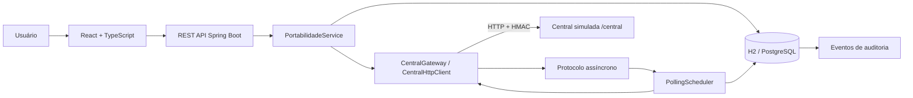

# Arquitetura e fluxo

## Estados

- PENDENTE: protocolo recebido, aguardando processamento.
- CONFIRMADA: Central confirmou; parcelas ficam PORTABILIZADA.
- REJEITADA: Central rejeitou; parcelas retornam para ABERTA.
- FALHA_INTEGRACAO: falha ao registrar na Central ou confirmação não obtida após esgotar as consultas; parcelas voltam
  para ABERTA. Estados finais são imutáveis.

## Integridade

A assinatura HMAC-SHA256 cobre uma representação canônica do pedido (parcelas ordenadas) e as respostas da Central
(`X-Assinatura`).

## Idempotência

`Idempotency-Key` única no banco + hash do payload + bloqueio pessimista das parcelas + repasse da chave à Central.
Reenvios devolvem a mesma operação.
